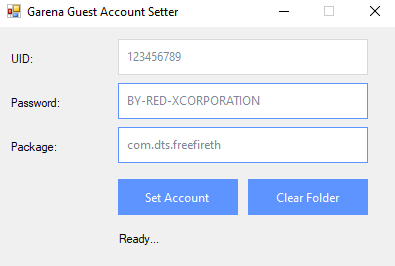

# FF Guest Account Login (UID & Password)

A professional Windows-based tool developed by **REDX CORPORATION** that allows direct login into **Free Fire guest accounts** using **UID and Password** inside the HD-Player (BlueStacks/MSI) emulator.

<p align="center">
  
</p>

---

## 📌 Overview

This project is designed specifically for **Free Fire** and provides a fast and automated way to:

- Login into existing guest accounts using UID & Password  
- Replace current guest session data  
- Reset guest accounts to generate new ones  

Instead of manually handling emulator files, this tool automates everything using **ADB communication with HD-Player**.

---

## 🚀 Features

### 🔐 Guest Login System
- Login directly using:
  - **UID**
  - **Password**
- Automatically injects login data into Free Fire guest storage
- No manual file editing required

### 🔄 Instant Account Switching
- Quickly switch between multiple guest accounts
- Saves time for testing, managing, or using different accounts

### 🧹 Guest Reset System
- Clears guest account data
- Forces Free Fire to create a **new guest account**

### 🖥️ User-Friendly UI
- Clean and simple interface
- Real-time status updates
- Error handling and confirmations

---

## ⚙️ How It Works

The application interacts with **Free Fire’s guest login system** by modifying its local storage inside the emulator.

### Process:

1. Detects running **HD-Player (BlueStacks)**  
2. Locates internal **ADB (HD-Adb.exe)**  
3. Writes guest login data into:
   ```/storage/emulated/0/com.garena.msdk/guest100067.dat```
4. Uses structured JSON format:
```json
{
  "guest_account_info": {
    "com.garena.msdk.guest_uid": "YOUR_UID",
    "com.garena.msdk.guest_password": "YOUR_PASSWORD"
  }
}
```
5. Applies proper permissions

---


## 🛠️ Requirements
- Windows 10 / 11
- BlueStacks/MSI Emulator (HD-Player)
- Free Fire installed inside emulator
- ## ▶️ Usage
1. Start BlueStacks (HD-Player)  
2. Open Free Fire at least once  
3. Launch the tool  
4. Enter:  
   - UID  
   - Password  
5. Click **Set / Login**  

---

## ⚠️ Important Notes

- This tool is strictly for Free Fire guest accounts  
- Emulator must be running before use  
- Do not modify files manually while tool is running  
- Always ensure correct UID & Password  

---

## ❗ Disclaimer

This project is created for **educational and research purposes only**.

- Do not use on accounts you do not own  
- Misuse may violate game policies  
- The developer is not responsible for any misuse or consequences  

---

## 👑 Author

**REDX CORPORATION**  
Developed by **Mohtasim Billah Jitu**  

---

## ⭐ Support

If you like this project, consider giving it a **star ⭐** on GitHub and sharing it with others.
